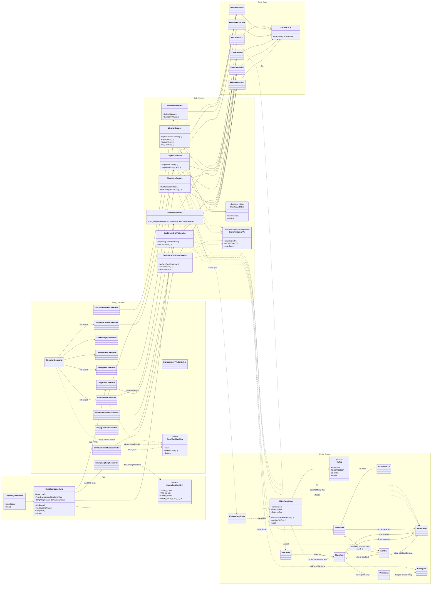

# Sơ đồ lớp tổng quát – DentaFlow hiện tại

Sơ đồ thể hiện các lớp chính đang có trong Java source và hướng phụ thuộc giữa các tầng. `Entity` là mô hình dữ liệu dùng chung, không phải tầng xử lý thứ tư.

## Những điểm sơ đồ phản ánh đúng source

- Các Controller thuộc GUI gọi Service; Service kiểm tra vai trò/nghiệp vụ và gọi DAO; DAO dùng JDBC thông qua `KetNoiCSDL`.
- `TiepNhanService` xử lý cả có hẹn và không hẹn, tạo/liên kết hồ sơ rồi tạo `PhieuKham` trong transaction.
- `DanhSachChoYTaService` chỉ đọc phiếu khám theo quyền/phòng được phân công; trạng thái được cập nhật bởi luồng Nha sĩ.
- `QuyTacLichHen` hiện áp dụng lịch hẹn 45 phút cố định.
- Một số lớp dùng cho chức năng đăng nhập, tiếp nhận, lịch hẹn và danh sách chờ có đầy đủ tầng hơn các module quản lý.

## Những phần chưa thể hiện thành Java class hiện tại

Schema SQL có thêm các bảng `DichVu`, `ChiTietPhieuKham`, `DonThuoc`, `ChiTietDonThuoc`, `HoaDon`, `ChiTietHoaDon`, `ThanhToan`, `PhongKham` và các view báo cáo. Source hiện chưa có Entity/DAO/Service đầy đủ tương ứng cho các module đó. Nhân sự, phân công quản lý, dịch vụ, báo cáo và thu ngân cũng chưa có backend hoàn chỉnh theo README. Vì vậy không nên vẽ các lớp backend này như thể đã triển khai.
