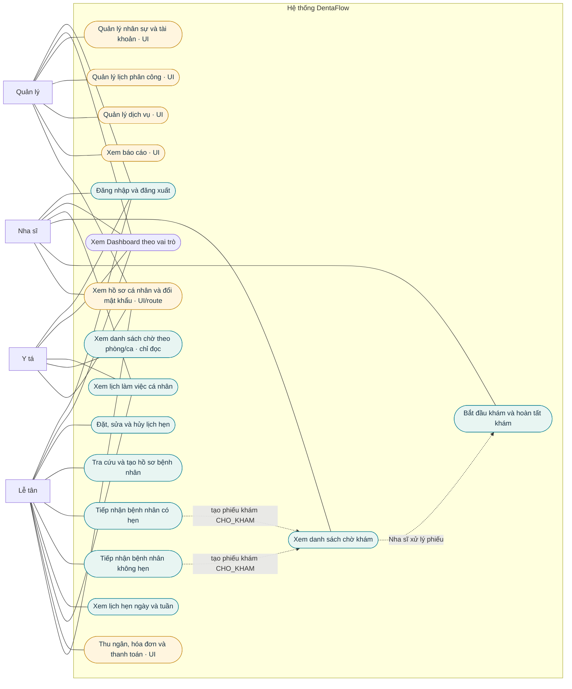

# Sơ đồ Use Case tổng quát – DentaFlow hiện tại

Sơ đồ này phản ánh các vai trò và màn hình/luồng đã có trong source hiện tại. Các chức năng có giao diện nhưng backend chưa hoàn chỉnh được đánh dấu **UI** để không nhầm là nghiệp vụ đã chạy đầy đủ.

## Ghi chú phạm vi

- Sơ đồ gom nhóm theo màn hình/luồng hiện có trong source; chưa đánh số UC để tránh nhầm với 14 UC chính thức trong báo cáo môn học. Cần đối chiếu bảng UC chính thức trước khi chèn vào báo cáo.
- Đăng nhập SQL thật, đặt/sửa/hủy lịch, tra cứu/tạo hồ sơ bệnh nhân, tiếp nhận, cấp số khám, danh sách chờ Nha sĩ/Y tá và cập nhật trạng thái khám đã có lớp xử lý trong source.
- Nhân sự, CRUD phân công, dịch vụ, báo cáo, thu ngân/hóa đơn/thanh toán và một số màn hình tài khoản hiện mới có route/UI hoặc chưa có bộ Controller–Service–DAO đầy đủ; sơ đồ đánh dấu UI.
- Y tá chỉ xem hàng chờ. Việc gọi bệnh nhân thực hiện ngoài phần mềm; Y tá không đổi trạng thái phiếu khám.
- Dashboard được ánh xạ theo vai trò trong điều hướng. Nội dung dữ liệu thực tế tùy từng màn hình và mức backend đã nối.
